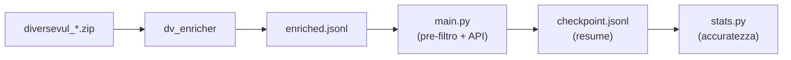

# VulnLabelAnalyzer


Framework LLM-based (solo API) per misurare l'accuratezza delle etichette del dataset **DiverseVul**: rileva le funzioni erroneamente etichettate come vulnerabili a causa del *commit tangling*.

## Indice

- [Panoramica](#panoramica)
- [Requisiti](#requisiti)
- [Quick start](#quick-start)
- [Workflow](#workflow)
  - [1. Arricchimento](#1-arricchimento)
  - [2. Classificazione](#2-classificazione)
  - [3. Statistiche](#3-statistiche-statspy)
- [Tassonomia](#tassonomia)
- [Opzioni di `main.py`](#opzioni-di-mainpy)
- [Struttura del progetto](#struttura-del-progetto)
- [Test](#test)

## Panoramica

DiverseVul etichetta come *vulnerabili* (`target=1`) **tutte** le funzioni toccate da un commit che corregge un CVE. Refactoring, adeguamenti di API, logging e codice di test finiscono così marcati come vulnerabili.

Il framework lavora in tre passi:

1. **Arricchimento** (`dv_enricher`): localizza ogni funzione nel repository Git, estrae il diff e calcola segnali deterministici.
2. **Classificazione** (`main.py`): un modello via **Gemini API** assegna a ogni funzione una categoria DiverseVul. Un pre-filtro deterministico evita la chiamata API per i casi palesemente cosmetici o in codice di test.
3. **Misura** (`stats.py`): l'unico modulo di statistiche: accuratezza delle label, intervalli di confidenza, rumore per progetto/commit, metriche dalla revisione manuale.



## Requisiti

- Python 3.11+, **nessuna dipendenza obbligatoria** (solo stdlib).
- *Opzionale:* [`json-repair`](https://pypi.org/project/json-repair/) (`pip install json-repair`) per recuperare le risposte del modello con JSON malformato.
- Git nel PATH (solo per `dv_enricher`).
- Una chiave API Gemini (<https://aistudio.google.com/apikey>), passata **solo** via variabile d'ambiente:

```bash
export GEMINI_API_KEY="..."        # oppure GOOGLE_API_KEY   (PowerShell: $env:GEMINI_API_KEY="...")
```

## Quick start

```bash
git clone https://github.com/<utente>/vuln_label_analyzer.git
cd vuln_label_analyzer
export GEMINI_API_KEY="..."

# 1. arricchimento
python -m dv_enricher --dataset diversevul_20230702.zip --out enriched.jsonl --workdir work --workers 4

# 2. classificazione
python main.py --dataset enriched.jsonl --model gemini-3.8-flash --workers 4 --rpm 60

# 3. statistiche
python stats.py summary --checkpoint data/output/gemini/checkpoint.jsonl
```

## Workflow

### 1. Arricchimento

```bash
python -m dv_enricher --dataset diversevul_20230702.zip --out enriched.jsonl --workdir work --workers 4
```

Riprendibile: i record già in `enriched.jsonl` e i repository già clonati vengono riusati. Opzioni utili: `--project`, `--sample N`, `--hashes-file`, `--nvd`, `--repo-map`.

<details>
<summary><b>Schema v2 e <code>--refresh</code></b></summary>

Ogni record ha `change.function_diff`: il diff ristretto alle sole righe della funzione (più 3 righe di contesto), con le `+` abbinate alle `-` che sostituiscono anche dentro blocchi di modifica enormi.

Le versioni precedenti passavano al modello gli *hunk interi* del file, troncati ai primi N caratteri: in una riscrittura estesa (es. libreria aggiornata) un solo hunk copre decine di funzioni e le righe della funzione esaminata sparivano, quindi il modello vedeva solo altre funzioni e dichiarava la funzione «non modificata». Per correggere un `enriched.jsonl` vecchio:

```bash
python -m dv_enricher --dataset diversevul_20230702.zip --out enriched.jsonl --workdir work --refresh
```

`--refresh` rielabora solo i record con `schema_version` < 2 e **aggiunge** le nuove righe in coda; in lettura, per ogni hash vince l'ultima riga.

Se non lo fai, `main.py` classifica comunque i record vecchi i cui hunk sono completi (il diff viene ritagliato al volo), e **salta senza chiamare l'API e senza scrivere nel checkpoint** quelli il cui diff era già stato troncato prima di arrivare alla funzione (lo segnala nel log).

Limiti di caratteri: `--max-hunk-chars` (hunk interi, usati dal pre-filtro) e `--max-function-diff-chars` (diff per il modello; se supera il limite si tengono testa e coda). Timeout per comando git: variabile `DV_GIT_TIMEOUT` (default 900 s).

</details>

### 2. Classificazione

```bash
python main.py --dataset enriched.jsonl --model gemini-3.8-flash --workers 4 --rpm 60
```

Il **thinking è `high` di default** (`--thinking minimal|low|medium|high|default`). `default` non invia `thinkingConfig`: serve per modelli senza livelli di thinking (es. Gemma); se il modello rifiuta il thinking l'errore è fatale e chiaro, non una riga rovinata per ogni record. Il thinking consuma token di output, per questo `--max-output-tokens` è 32768.

Per il free tier (≈500 richieste/giorno) usa un modello Flash-Lite, ad es. `--model gemini-3.5-flash-lite --rpm 15`; verifica i limiti nella pagina Rate limit di AI Studio.

#### Pre-filtro deterministico

Evita la chiamata API (e assegna `predicted_target = 0`) solo quando il risultato è **verificato sul codice**:

| Caso | Categoria |
|---|---|
| File di test / esempi / fuzz confermato dal path (`test/`, `libtests/`, `examples/`, `fuzz/`, `*_test.c`, `*-ctest.c`, `standalone_fuzz_*`…). Scatta dal solo path; `latest.c` e `contest.c` non sono test | `WRONG_LABEL_IRRELEVANT` |
| Modifica cosmetica (whitespace, commenti) **verificata** con confronto order-sensitive dei token C/C++ | `WRONG_LABEL_IRRELEVANT` |
| Commento/doc modificato e nome della funzione citato nel messaggio di commit (il commento documenta il comportamento del fix) | `WRONG_LABEL_CONSISTENCY` |

Tutto ciò che non è verificabile (hunk troncati o incoerenti, localizzazione non esatta, estensione non C-like, modifiche strutturali) va **sempre** al modello: nessun fallback euristico sui segnali dell'enricher.

#### Prompt stateless

Ogni richiesta è indipendente: il prompt è una funzione pura del singolo record, senza memoria delle altre funzioni. Le istruzioni statiche stanno all'inizio (cache-friendly), i dati del record dopo.

- **Procedura decisionale fissa** (Q1–Q7) con regole di confine tra categorie, e campi di ragionamento prima dell'etichetta.
- **`<evidence_rules>`**: vietano di attribuire alla funzione modifiche di altre funzioni, impongono `UNDETERMINABLE` se il diff manca o è mal ristretto, vietano le auto-correzioni nei campi di ragionamento.
- **Coerenza nei commit «a tappeto»** (stessa modifica meccanica in decine di funzioni: pulizia di warning, hardening di conversioni, migrazione di API) tramite un rubric per istanza (`<sweep_rules>`) e numeri calcolati dal record stesso (`<commit_profile>`), non tramite memoria tra chiamate. Il rubric chiede di:
  1. nominare il pattern ricorrente e decidere se il commit è un vero fix o una pulizia;
  2. classificare l'**operando**: *influenzato dall'esterno* (input, argv, dati parsati e tutto ciò che ne deriva: conteggi, lunghezze, dimensioni di contenitori riempiti da dati parsati) oppure *provatamente innocuo* (costante, `sizeof`, contatore di ciclo limitato);
  3. applicare lo stesso test a ogni sito: operando esterno che la modifica mette in sicurezza → `CORRECT_LABEL`; operando innocuo, modifica che silenzia solo un warning o protezione già presente → `WRONG_LABEL_CONSISTENCY`. L'onere della prova è su CONSISTENCY: il dubbio sulla raggiungibilità non basta a declassare.
- **`WIDE SWEEP`** (`<commit_profile>`) è «sì» solo se il commit ha molte funzioni segnalate, poche righe modificate in media **e** modifiche uniformi o un messaggio che descrive una modifica di massa. Un commit eterogeneo (es. un fix di locking) non attiva le sweep rules anche se ha molte funzioni.
- Rename e cambi di firma che adottano il **nuovo protocollo** del fix (locking, ownership, lifetime, errori) sono `WRONG_LABEL_SPREAD`, non `CONSISTENCY`.
- Il nome funzione estratto male (es. una macro come `__acquires`) viene ricavato di nuovo dalla firma.

Ogni risultato salva `prompt_version`, `thinking_level`, `diff_truncated`, `wide_sweep`. Se il checkpoint contiene risultati di un'altra versione del prompt, `main.py` lo segnala: per riclassificare usa un `--out-dir` nuovo (o `--no-resume`).

#### Checkpoint, resume e errori

- Il **checkpoint** (`<out-dir>/checkpoint.jsonl`, una riga JSON per funzione) viene scritto dopo ogni record. Se il run si interrompe (crash, Ctrl+C, quota giornaliera) rilancia lo stesso comando: i record già presenti vengono saltati. `--no-resume` rielabora tutto.
- **Non vengono scritti nel checkpoint** (così sono ritentati): quota giornaliera esaurita, chiave non valida, API non raggiungibile/sovraccarica dopo i retry.
- **Risposte non parsabili ≠ `UNDETERMINABLE`.** Il parser prova `json.loads`, poi `json-repair` (se installato). Se anche questo fallisce il record ha `category = null`, `predicted_target = null`, `parse_error = true`, `needs_retry = true`: è un fallimento della pipeline, non un verdetto, e va ritentato. Se l'API segnala `finish_reason = length`, ritenta con `--max-output-tokens` più alto. Le risposte bloccate dai filtri del provider sono registrate come `UNDETERMINABLE` con `parse_error = true`.
- Il run si ferma da solo alla prima quota giornaliera esaurita o dopo 8 errori transitori consecutivi.
- Se il checkpoint contiene risultati di un altro modello, viene mostrato un avviso: quei record **non** vengono rielaborati. Per valutare un nuovo modello da solo usa un `--out-dir` diverso.
- A fine run vengono scritti `results.csv`, `results_full.jsonl` (con `raw_output`), `accuracy_summary.json` e `stats_report.txt`.

### 3. Statistiche (`stats.py`)

```bash
# accuratezza delle label stimata dal classificatore
python stats.py summary --checkpoint data/output/gemini/checkpoint.jsonl

# CSV per la verifica manuale (colonna `verdetto` da compilare)
python stats.py export-review --checkpoint data/output/gemini/checkpoint.jsonl

# metriche dalla revisione manuale + accuratezza corretta del dataset
python stats.py review data/output/gemini/review_llm.csv data/output/gemini/review_static.csv \
       --checkpoint data/output/gemini/checkpoint.jsonl
```

#### `summary`

Accuratezza = record non rumorosi / record validi, con intervallo di Wilson al 95%, per: totale, metodo (`llm` / `deterministic`), categoria, progetto, e rumore medio ± dev.std. per commit.

*Record valido* = senza `parse_error` e con `predicted_target ∈ {0,1}`. Parse error e `UNDETERMINABLE` sono esclusi dal denominatore e riportati a parte.

#### `export-review`

Scrive `review_llm.csv` e `review_static.csv`. Compila la colonna `verdetto` con:

| Verdetto | Significato |
|---|---|
| `ok` | il classificatore ha ragione |
| `ERROR` | il classificatore ha torto (la verità è `1 - predicted_target`) |
| `idk` | non so decidere (escluso dalle metriche principali) |
| vuoto | non revisionata (esclusa) |

Opzioni: `--only-disagreements`, `--include-parse-errors`, `--repo-map` (JSON `{"progetto": "owner/repo"}` per la colonna `commit_url`).

#### `review`

Da uno o più CSV compilati calcola: accuracy del classificatore (con IC95 e limiti con `idk` = errore / = ok), matrice di confusione, precision/recall/F1 per classe, macro-F1, balanced accuracy, MCC, Cohen's kappa, tabelle per `category`/`project` (`--group-by`).

Con `--checkpoint` calcola anche l'**accuratezza corretta delle label del dataset**: la precisione dei record segnalati come rumore e il rumore mancato tra i non segnalati (se ne hai verificati a campione) vengono estrapolati all'intero dataset. Senza record non segnalati verificati la stima è un limite superiore. Scrive `review_metrics.txt` e `review_metrics.json`.

## Tassonomia

| Categoria | `predicted_target` | Significato |
|---|:---:|---|
| `CORRECT_LABEL` | **1** | Il corpo pre-fix contiene il difetto e una riga modificata lo ripara: etichetta corretta. |
| `WRONG_LABEL_SPREAD` | **0** | Il fix è sparso su più funzioni; questa ne porta una parte rilevante per la sicurezza (nuovo limite/flag/errore propagato, adozione del nuovo protocollo di locking/ownership) ma il difetto sta altrove. |
| `WRONG_LABEL_CONSISTENCY` | **0** | Modifica meccanica senza semantica di sicurezza: adeguamento di firma/tipo/API, rename, commento/doc. |
| `WRONG_LABEL_FEATURE` | **0** | La modifica aggiunge funzionalità invece di riparare un comportamento difettoso. |
| `WRONG_LABEL_IRRELEVANT` | **0** | Modifica irrilevante: refactoring, logging, test/esempi/fuzz, formattazione. |
| `UNDETERMINABLE` | **−1** | Contesto insufficiente o contraddittorio. Escluso dal calcolo. Non è un errore di parsing. |

## Opzioni di `main.py`

| Flag | Default | Descrizione |
|---|---|---|
| `--dataset` | `enriched.jsonl` | JSONL prodotto da `dv_enricher` |
| `--out-dir` | `data/output/gemini` | Cartella di checkpoint, risultati e statistiche |
| `--model` | `gemini-3.8-flash` | Modello Gemini |
| `--workers` | `4` | Richieste parallele |
| `--rpm` | `10` | Tetto richieste/minuto lato client (0 = nessun tetto). **Impostalo al limite del tuo account** |
| `--temperature` / `--seed` | `0.2` / `42` | Campionamento / riproducibilità |
| `--timeout` | `300` | Timeout per richiesta (s) |
| `--retries` | `5` | Tentativi su errori transitori (5xx/rete), back-off esponenziale |
| `--max-output-tokens` | `32768` | Token massimi in output (thinking incluso) |
| `--thinking` | `high` | `minimal` / `low` / `medium` / `high` / `default` (= non inviare `thinkingConfig`) |
| `--base-url` | API Google | Solo per proxy/test |
| `--limit` | `0` (tutti) | Limita il numero di record |
| `--max-per-commit` | `0` (nessun cap) | Cap di funzioni per commit (riduce il peso dei commit giganti) |
| `--skip-deterministic` | `False` | Invia tutto all'API, senza pre-filtro |
| `--no-resume` | `False` | Non saltare i record già nel checkpoint |

**Gestione dei limiti:** i 429 al minuto attendono il `retryDelay` indicato dal server (tutti i thread insieme); una quota giornaliera esaurita ferma il run in modo pulito; `limit: 0` o chiave non valida sono errori fatali (exit code 1).

## Struttura del progetto

```
vuln_label_analyzer/
├── main.py                  # classificazione via API (Passo 2)
├── stats.py                 # unico modulo di misura: summary / export-review / review
├── core/
│   ├── llm_engine.py        # client Gemini: rate limiter, gestione 429, retry
│   ├── pipeline.py          # pre-filtro + chiamate API + checkpoint/resume
│   ├── deterministic.py     # pre-filtro senza API
│   ├── prompting.py         # prompt + tassonomia
│   ├── parser.py            # parsing/validazione della risposta
│   ├── checkpoint.py        # JSONL incrementale
│   └── ingestion.py         # lettura enriched.jsonl
├── dv_enricher/             # Passo 1: arricchimento (python -m dv_enricher)
├── tests/
│   ├── test_pipeline.py     # mock API, nessuna rete
│   └── test_diff_scope.py   # diff ristretto, prompt, thinking, --refresh, repo git reale
└── data/output/             # checkpoint e risultati
```

## Test

```bash
python -m unittest discover -s tests -v
```

I test non usano la rete (API simulata).
